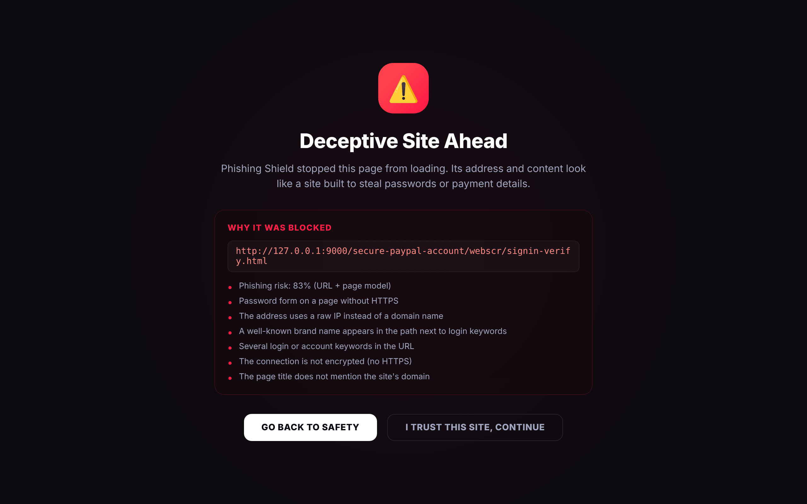
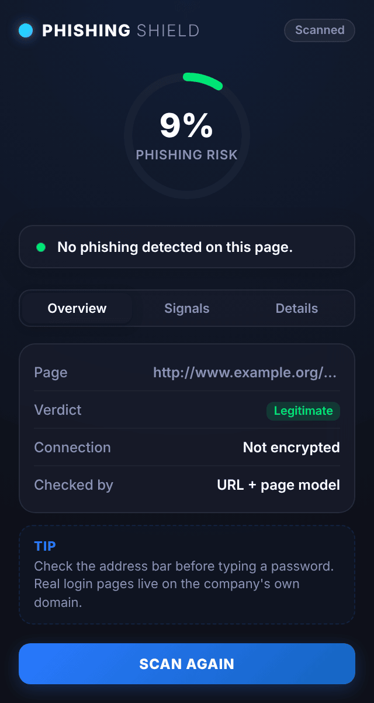
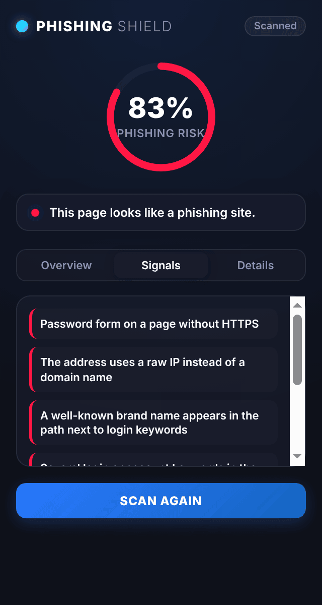
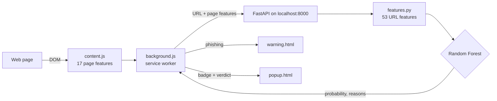

<div align="center">

# Phishing Shield

A Chrome extension that checks every page you open with a machine learning model,<br />
and stops you before you land on a phishing site.

<br />


<sub>Machine learning project · Phishing detection · Solo project</sub>

[How it works](#how-it-works) &nbsp;·&nbsp; [Results](#results) &nbsp;·&nbsp; [Getting started](#getting-started) &nbsp;·&nbsp; [Limitations](#limitations)

<br />



</div>

## Overview

When a page finishes loading, the extension reads the structure of the page (links, forms, scripts, title) and sends those numbers with the URL to a small API running on your machine. A Random Forest model trained on 11,430 labelled websites returns a phishing probability. Above 70% the tab is redirected to a warning page that lists the reasons, between 50% and 70% the page is marked as suspicious.

Nothing is sent to a third party: the API runs on `localhost`, and the page content itself never leaves the browser.

<table>
  <tr>
    <td width="50%" align="center"><p><b>Legitimate page</b></p></td>
    <td width="50%" align="center"><p><b>Phishing page, with the signals that triggered it</b></p></td>
  </tr>
</table>

<sub>Screenshots taken in Chromium with the unpacked extension, on a local demo page built to look like a credential-harvesting form.</sub>

## How it works



| Part | Role |
|---|---|
| `extension/content.js` | Measures the page: share of internal and external links, empty or `#` anchors, password forms, external favicon and stylesheets, hidden iframes, disabled right-click, whether the title and copyright mention the domain |
| `extension/background.js` | Calls the API, caches the verdict per tab, sets the toolbar badge, redirects to the warning page, remembers the sites you chose to trust for the session |
| `extension/popup.*` | Risk score, verdict, the signals behind it and a few page statistics |
| `backend/features.py` | Computes 53 features from the URL (length, digits, subdomains, IP host, punycode, shorteners, suspicious TLDs, brand names in the subdomain, login keywords...) and turns them into readable reasons |
| `backend/api.py` | `POST /predict` and `GET /health`. Uses the page model when page features are present, the URL-only model otherwise, and skips a short list of well-known domains |
| `backend/train_model.py` | Rebuilds both models from the dataset in about 10 seconds |

If the API is not running, the extension falls back to a few transparent rules (IP host, `@` in the URL, login keywords, password form without HTTPS) and labels the result as such.

## Results

Stratified 80/20 split of the dataset (9,144 training and 2,286 test pages), Random Forest with 300 trees:

| Model | Features | Accuracy | Precision | Recall | F1 | ROC AUC |
|---|:---:|:---:|:---:|:---:|:---:|:---:|
| URL only | 53 | 90.3% | 89.6% | 91.3% | 0.904 | 0.964 |
| URL + page | 70 | **94.1%** | **94.2%** | **93.9%** | **0.940** | **0.983** |

The most useful signals are the number of links on the page, login and account keywords in the URL, and the share of links pointing to other sites.

### What changed from the first version

The first version trained on all 87 columns of the dataset, including WHOIS age, Google index, PageRank and web traffic. The API cannot get those values, so it filled them with fixed guesses, and some of those guesses were the values the dataset uses for phishing sites. The extension also sent link and media ratios as 0 to 1 when the dataset stores them as percentages, and the manifest never registered the content script or the service worker, so automatic scanning did not run.

This version only trains on features the extension and API can compute themselves, recomputes the URL features from the raw URLs with the same code the API uses, and wires the whole extension together.

## Getting started

**Requirements**: Python 3.10+, Google Chrome or another Chromium browser.

```bash
pip install -r requirements.txt
python backend/train_model.py          # builds backend/models/ (about 10 s)
cd backend
uvicorn api:app --port 8000            # http://localhost:8000/docs
```

Then load the extension:

1. Open `chrome://extensions` and turn on **Developer mode**
2. Click **Load unpacked** and pick the `extension/` folder
3. Pin **Phishing Shield** and browse as usual

Quick check from the terminal:

```bash
curl -X POST localhost:8000/predict -H "Content-Type: application/json" \
     -d '{"url": "http://paypal.com.secure-login.verify-account.xyz/webscr/signin.php"}'
```

Run the tests with `pytest`.

## Project structure

```
phishing-detector-extension-ml/
├── backend/
│   ├── api.py            # FastAPI service
│   ├── features.py       # URL features, page feature list, explanations
│   ├── train_model.py    # trains the URL and URL + page models
│   └── models/           # metrics.json (models are rebuilt locally)
├── extension/            # Manifest V3 extension
├── data/
│   └── dataset_phishing.csv
├── tests/
└── docs/screenshots/
```

## Limitations

- The dataset dates from 2020. Phishing kits change quickly, so the model will miss newer tricks and should not replace the browser's own Safe Browsing protection.
- URL-only predictions are weaker: long URLs on legitimate sites can score as suspicious. The page model, used automatically when a page loads, is more reliable.
- The page features follow the dataset's definitions as closely as possible, but the dataset was built with a different crawler, so values are approximations.
- The trusted-domain list is short and only skips the model, it does not mean a page is safe.

## Dataset

*Web page phishing detection* by Abdelhakim Hannousse and Salima Yahiouche, Mendeley Data, 2021, [doi:10.17632/c2gw7fy2j4.3](https://doi.org/10.17632/c2gw7fy2j4.3), licensed CC BY 4.0. 5,715 legitimate and 5,715 phishing URLs with page and external features.

---

<div align="center"><sub>Part of <a href="https://github.com/creepout777">Yassine Aitaouicha's projects</a></sub></div>
